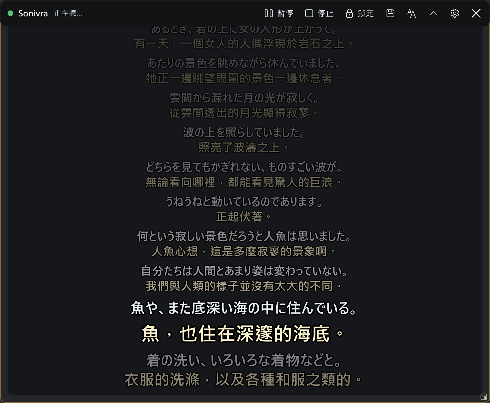
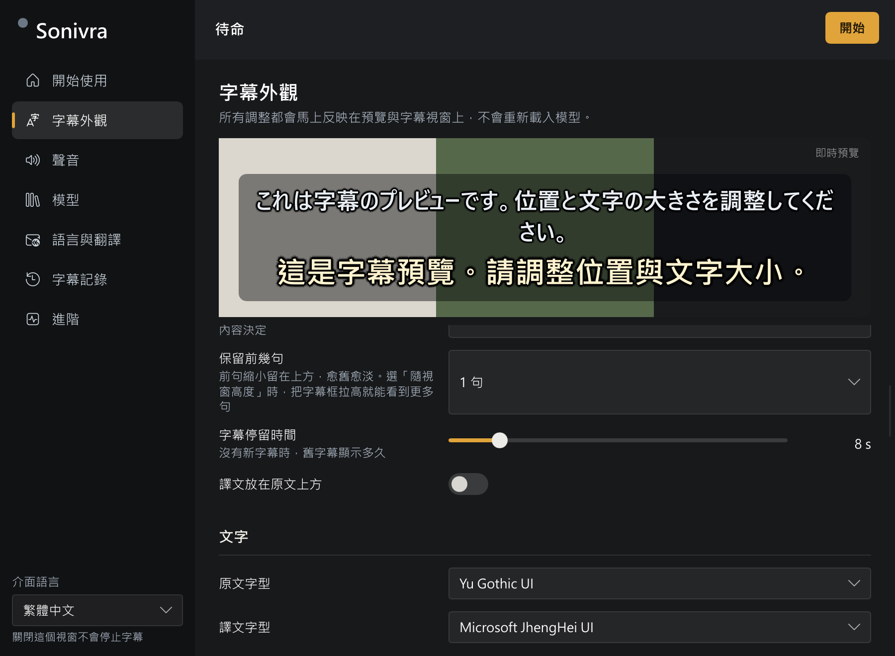

<div align="center">

# Sonivra

Local real-time speech recognition and translated subtitles (Japanese → Traditional Chinese)

<p>


</p>

[繁體中文](README.md) ・ [English](README.en.md) ・ [日本語](README.ja.md)



</div>

## Overview

Sonivra is a subtitle application for Windows 11. It captures the audio the system is playing, recognizes Japanese speech as text, translates it into Traditional Chinese, and displays the result in an always-on-top subtitle window. Recognition and translation both run locally. Audio and text are not sent anywhere.

The application is a single native executable written in Rust with [Slint](https://slint.dev/). It does not use Electron or a WebView, and it does not require a resident Python or Node process.

## Requirements

- Windows 11 x64
- An NVIDIA GPU is recommended. Translation uses the CUDA build of llama.cpp and recognition uses the Vulkan build of speech.cpp
- The default model pair (Qwen3-ASR 1.7B Q4_K and PLaMo 3 Translate 2B Q4_K_M) takes about 2.9 GB, and the runtimes are downloaded separately

## Installation

1. Extract `Sonivra-<version>-windows-x64.zip` to any folder.
2. Run `Sonivra.exe`.
3. On the "Get started" page, download the runtimes and models as prompted. Downloads use pinned versions and are verified with SHA-256.
4. Select "Start".

The `portable` file in the folder keeps settings, models and transcripts in the same folder. Without it, data is stored in `%LOCALAPPDATA%\Sonivra`.

## Features

| Area | Description |
|---|---|
| Recognition and translation | Run locally. Median time from end of speech to finished translation is 606 ms (RTX 5070) |
| Provisional text | During speech, the audio received so far is recognized every 0.8 s and shown dimmed until the complete sentence replaces it |
| Subtitle window | Always on top, can be transparent and can pass mouse clicks through. Window height sets the number of lines shown, up to 300, with older lines fading |
| Appearance | Size, font, color, background opacity and text effect can be changed in the subtitle window |
| Audio source | Default output device, a single program, the microphone, or system sound mixed with the microphone |
| Transcript | Search and review. Export as TXT, SRT or WebVTT. Optional automatic saving and recording of the recognized audio |
| Streaming output | The current subtitle is written to `transcripts\live.txt` for an OBS text source |
| Look profiles | Save and load appearance, context note, glossary and recognition hints |
| Interface language | 繁體中文, English, 日本語 |

## Usage



- Drag the title bar to move the window. Drag any edge or corner to resize it.
- Scroll to review earlier lines. The window returns to live subtitles after 20 seconds without input. Ctrl+scroll changes the text size and Shift+scroll changes the background opacity.
- The title bar can be set to stay visible, appear on hover, or be hidden. Right-click opens settings.
- Mouse click-through can be enabled once the window is locked.

| Hotkey | Action |
|---|---|
| `Ctrl+Alt+L` | Lock or unlock |
| `Ctrl+Alt+P` | Start, pause, resume |
| `Ctrl+Alt+H` | Show or hide the subtitle window |
| `Ctrl+Alt+↑` / `↓` | Review earlier or later lines |
| `Ctrl+Alt+=` / `-` | Increase or decrease text size |
| `Ctrl+Alt+S` | Save the current transcript immediately |

## Transcript, recording and streaming output

- Starting again after a pause or stop continues the same transcript.
- The save button on the title bar, or `Ctrl+Alt+S`, writes the current transcript as TXT to the `transcripts` folder.
- With "Write live subtitle to a text file" enabled, the on-screen subtitle is mirrored to `transcripts\live.txt`.
- With "Record the recognized sound" enabled, the audio sent to recognition (silence included) is saved as a 16 kHz mono WAV, one file per start, at about 115 MB per hour. The recording and the transcript share the same starting point.
- "Earlier lines show" selects translation only, original only, or both.

## Languages

The spoken language can be specified or set to automatic detection. With automatic detection, the translation source language is also determined automatically. The tested pair is Japanese to Traditional Chinese, and the translation target list contains 53 languages.

## Experimental features

These are disabled by default and can be enabled in settings.

- **Translate provisional text**: while the translator is idle, the provisional original is translated and shown dimmed. It is skipped while latency is high or speech is queued.
- **Re-translate the previous sentence**: once the next sentence is translated and the translator is idle, the previous sentence is translated again using the next one as context. The screen and transcript are updated if the translation changed.

## Limits

- Sentence segmentation uses RMS level detection, not a speech model. Background music is treated as speech, and a very quiet source can fall below the threshold. The sensitivity can be raised on the Audio page.
- Provisional text can differ from the final result. Only final results are translated and recorded.
- Recognition and translation each use one worker, with queue lengths of 2 and 1. When processing falls behind, the older segment is dropped.
- Re-translation updates only the screen and exports. The automatically saved file is unchanged.
- With the microphone enabled, the microphone picks up speaker output again. Headphones are recommended.
- Not provided: speaker labels, re-recognition of recent audio, a second subtitle window, an installer, automatic updates.

## Measurements

Conditions: release build, default model pair, a 75-second continuous Japanese reading (LibriVox, "Akai rōsoku to ningyo", public domain) captured through WASAPI loopback. Test machine: NVIDIA GeForce RTX 5070 (12 GB), 32 GB RAM, Windows 11.

| Item | Value |
|---|---|
| Segments translated | 21, none dropped |
| End of speech to finished translation (median / 95th percentile) | 606 ms / 628 ms |
| Endpoint wait (last segment) | 420 ms |
| Recognition time (last segment) | 47 ms |
| Translation time to first token (last segment) | 35 ms |
| Main process memory | 65 MiB |
| Recognition worker memory | 258 MiB |
| Translation worker memory | 2,469 MiB |
| Whole-GPU usage (NVML) | 6,674 MiB while running, about 2,700 MiB without Sonivra |

Memory is the working set (RSS). GPU usage is the value for the whole card and includes other programs.

## Building from source

Requires Rust (edition 2024) and the Windows SDK.

```bash
cargo build --release
```

The executable is `target/release/Sonivra.exe`. `cargo test` runs the unit tests. `tests/real_models.rs` requires real models and runtimes and is skipped by default.

## License

Sonivra is licensed under [GPL-3.0-only](LICENSE). The statically linked Rust crates and their licenses are listed in [THIRD_PARTY_NOTICES.md](THIRD_PARTY_NOTICES.md).

Speech models and inference runtimes are not distributed with the program. They are obtained from their original sources when the user requests a download, each under its own license, recorded in `catalog.json` and `runtimes.json`. The PLaMo translation model, for example, is under the PLaMo Community License.

The Japanese clips in `tests/audio` are taken from Google FLEURS (CC BY 4.0). See [tests/audio/ATTRIBUTION.md](tests/audio/ATTRIBUTION.md).
