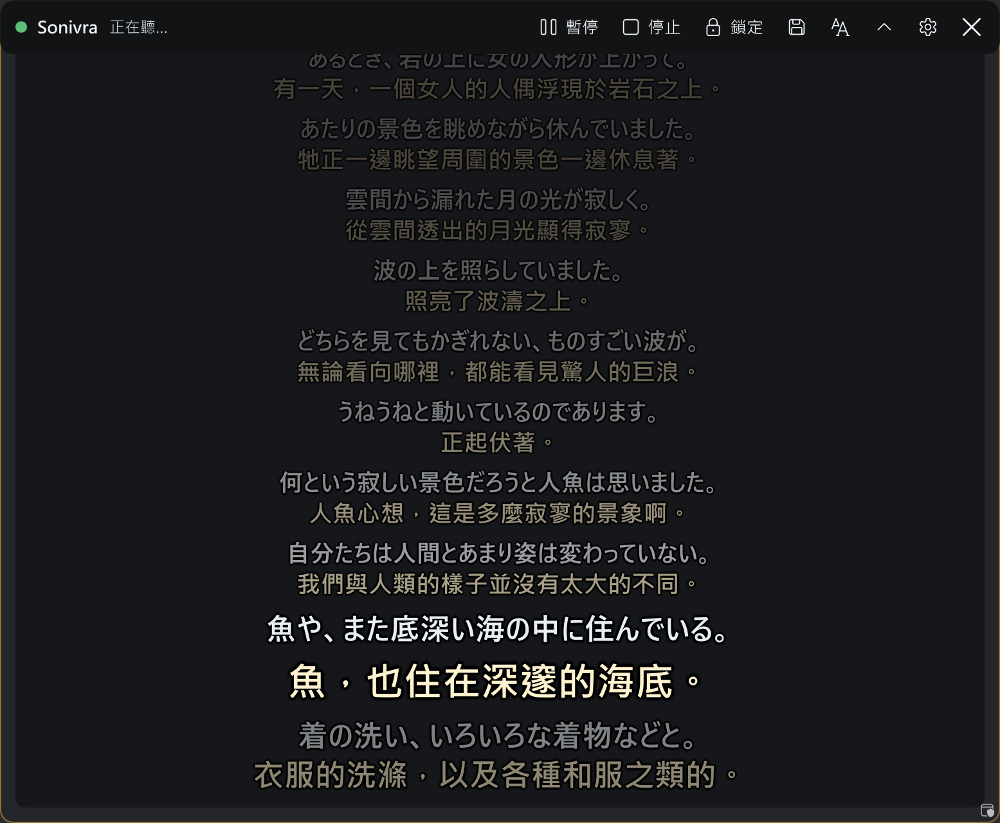
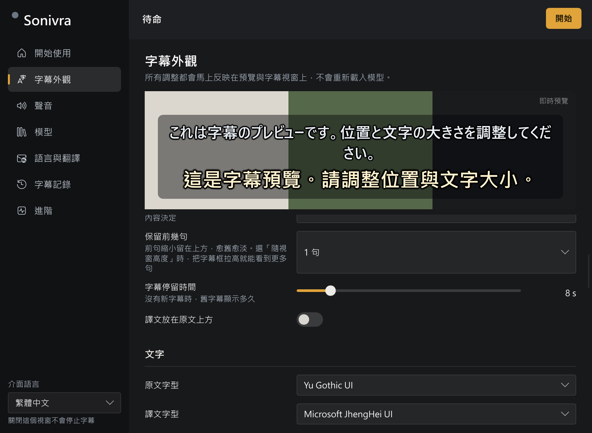

<div align="center">

# Sonivra

PC の音声をリアルタイムで文字起こし・翻訳する Windows 用字幕アプリ

<p>


</p>

[繁體中文](README.md) ・ [English](README.en.md) ・ [日本語](README.ja.md)



</div>

## Sonivra について

動画や配信を見ながら、PC から流れる音声を字幕で読めるアプリです。字幕は最前面のフローティングウィンドウに表示され、原文だけ、訳文だけ、両方の表示を選べます。

話されている言語と翻訳先の言語は、それぞれ設定できます。初期設定は日本語から台湾の繁体字中国語への翻訳で、動作確認もこの組み合わせを中心に行っています。ほかの言語でも使えますが、対応範囲は選んだモデルによって異なります。

標準設定では音声認識も翻訳も PC 内で処理するため、音声や文字起こしの内容を外部に送信しません。外部の翻訳 API を設定した場合は、翻訳するテキストがその接続先に送られます。

Rust と [Slint](https://slint.dev/) で開発しています。Python や Node.js のインストールは不要です。Electron や WebView も使っていません。

## ダウンロードと初期設定

1. [リリースページ](https://github.com/HsuanC0921/sonivra/releases/latest)から Windows 用 ZIP をダウンロードし、好きなフォルダーに展開します。
2. `Sonivra.exe` を起動します。
3. 初期設定の案内に従って、推論ランタイムとモデルをダウンロードします。配布元のバージョンは固定されており、SHA-256 でファイルを検証します。
4. 音声の入力元、認識する言語、翻訳先の言語を選び、開始します。

ZIP には `portable` というファイルが入っています。このファイルを実行ファイルと同じ場所に置いておくと、設定・モデル・文字起こしの保存先もそのフォルダーになります。`portable` がない場合の保存先は `%LOCALAPPDATA%\Sonivra` です。

### 動作環境

- Windows 11 x64
- 標準構成では NVIDIA GPU を推奨。翻訳には CUDA 版 llama.cpp、音声認識には Vulkan 版 speech.cpp を使用
- 標準のモデル 2 つで約 2.9 GB の空き容量が必要。ランタイムの保存容量は別途必要

標準モデルは Qwen3-ASR 1.7B Q4_K と PLaMo 3 Translate 2B Q4_K_M です。ダウンロード容量と実行時のメモリ使用量は異なります。メモリの実測値は後述の表を参照してください。

## 字幕ウィンドウの操作



字幕ウィンドウはほかのウィンドウより手前に表示されます。タイトルバーをドラッグすると移動でき、端や角をドラッグするとサイズを変えられます。フォント、文字サイズ、色、背景の不透明度、縁取りなども調整できます。新しい字幕が入るにつれて古い字幕が薄くなり、表示用に最大 300 件を保持します。

ホイールで過去の字幕を読み返せます。20 秒間操作しなければ最新の字幕に戻ります。Ctrl を押しながらホイールを回すと文字サイズ、Shift を押しながら回すと背景の不透明度を変更できます。

右クリックで設定を開きます。タイトルバーは常時表示、マウスを重ねたときだけ表示、非表示から選べます。ウィンドウをロックするとクリック透過を有効にでき、字幕の下にあるアプリをそのまま操作できます。

| ショートカット | 操作 |
|---|---|
| `Ctrl+Alt+L` | ウィンドウをロック／解除 |
| `Ctrl+Alt+P` | 開始／一時停止／再開 |
| `Ctrl+Alt+H` | 字幕の表示／非表示 |
| `Ctrl+Alt+↑` / `↓` | 過去の字幕を前後にスクロール |
| `Ctrl+Alt+=` / `-` | 文字サイズを拡大／縮小 |
| `Ctrl+Alt+S` | 現在の文字起こしを保存 |

## 音声と言語の設定

PC 全体の音声、特定のアプリ、マイクから入力元を選べます。PC の音声にマイクを混ぜることもできます。スピーカーの音をマイクが拾うと二重に入力されるため、併用する場合はヘッドホンをおすすめします。

認識する言語は手動で指定するか、自動検出に任せられます。自動検出では、翻訳元の言語も自動で判断します。翻訳の言語リストは 53 種類ありますが、実際に使える言語は音声認識モデルと翻訳モデルによって異なります。リストに載っているすべての言語の組み合わせを検証したわけではありません。

初期設定の場面説明は、日本語から繁体字中国語への字幕翻訳に合わせてあります。別の言語に翻訳する場合は、この説明も用途に合わせて書き換えてください。

文字起こしだけを使う場合は、翻訳をオフにしてください。アプリの表示言語は繁体字中国語、英語、日本語から選べます。

翻訳には直近の原文と訳文、場面の説明、用語集を渡せます。これらの設定や音声認識のヒントは、字幕の外観とまとめてプロファイルに保存できます。

## 文字起こしの保存・録音・OBS 連携

一時停止や停止をしても、現在の文字起こしは消えません。再開後の内容はその続きに追加されます。アプリ内で検索したり、TXT・SRT・WebVTT 形式で書き出したりできます。タイトルバーの保存ボタンか `Ctrl+Alt+S` を使うと、`transcripts` フォルダーに TXT で保存します。

設定で次の出力も有効にできます。

- **字幕のテキスト出力**：表示中の字幕を `transcripts\live.txt` に書き込みます。OBS のテキストソースから読み込めます。
- **音声の録音**：認識処理に渡した音声を、無音も含めて 16 kHz・モノラルの WAV に保存します。開始するたびに新しいファイルを作成し、容量は 1 時間で約 115 MB です。録音と字幕の時刻は同じ開始時点を基準にします。

文字起こしの自動保存は任意です。過去の字幕については、原文のみ、訳文のみ、両方から表示を選べます。

## 途中結果と試験的な機能

発話中は、そこまでに届いた音声を 0.8 秒ごとに文字起こしし、薄い文字で表示します。音声の区切りが確定すると、確定結果に置き換わります。途中結果は後から変わることがあります。保存する文字起こしには確定結果だけを追加し、標準設定では翻訳も確定後に行います。

次の 2 つは初期状態ではオフです。

- **途中結果も翻訳する**：翻訳処理に余裕があるときだけ、未確定の文字起こしも翻訳します。遅延が大きい場合や、未処理の音声がある場合は省略します。
- **前の文を訳し直す**：次の文を手掛かりに、直前の文をもう一度翻訳します。変更は画面とその後の書き出しに反映しますが、自動保存済みのファイルは書き換えません。

## 現在の制限

- 音声の区切りは RMS 音量を基準に判断します。音楽が流れ続けると区切れなかったり、小声を拾えなかったりすることがあります。音声設定で感度を調整してください。
- 認識と翻訳はそれぞれ 1 つのワーカーで処理します。待機できる音声は 2 区間、翻訳は 1 区間までで、処理が追いつかない場合は古い区間を破棄します。
- 話者の識別、直近の音声の再認識、複数の字幕ウィンドウ、インストーラー、自動更新には対応していません。

## 動作速度とメモリ使用量

以下は既存の release ビルドでの測定結果です。別の音声やモデル、PC で同じ速度が出ることを保証するものではありません。標準モデルを使い、LibriVox の朗読『赤い蝋燭と人魚』（パブリックドメイン）を 75 秒間、WASAPI ループバックで取り込みました。測定環境は Windows 11、RTX 5070（12 GB）、メモリ 32 GB です。

| 測定項目 | 結果 |
|---|---|
| 翻訳した区間数 | 21 区間、破棄なし |
| 発話終了から翻訳完了までの時間（中央値／P95） | 606 ms／628 ms |
| 発話終了を確定するまでの待ち時間（最後の区間） | 420 ms |
| 音声認識の処理時間（最後の区間） | 47 ms |
| 翻訳の最初のトークンが返るまで（最後の区間） | 35 ms |
| アプリ本体のメモリ使用量 | 65 MiB |
| 音声認識ワーカーのメモリ使用量 | 258 MiB |
| 翻訳ワーカーのメモリ使用量 | 2,469 MiB |
| GPU 全体のメモリ使用量（NVML） | 実行中 6,674 MiB、Sonivra 起動前は約 2,700 MiB |

メモリ使用量は各プロセスのワーキングセット（RSS）です。GPU の値にはほかのアプリの使用分も含まれます。

## ビルド

stable Rust と、Windows SDK を含む Visual Studio の C++ ビルドツールを用意して実行します。

```powershell
cargo build --release
```

`target/release/Sonivra.exe` が生成されます。単体テストは `cargo test` で実行できます。`tests/real_models.rs` の結合テストにはモデルとランタイムが必要なため、通常のテスト実行ではスキップされます。

## ライセンス

Sonivra のライセンスは [GPL-3.0-only](LICENSE) です。静的リンクする Rust クレートのライセンスは [THIRD_PARTY_NOTICES.md](THIRD_PARTY_NOTICES.md) にまとめています。

モデルと推論ランタイムは同梱していません。ユーザーがダウンロードを選んだときに配布元から取得し、それぞれのライセンスが適用されます。ライセンス情報は `catalog.json` と `runtimes.json` に記載しています。たとえば PLaMo モデルには PLaMo Community License が適用されます。

`tests/audio` の日本語音声は Google FLEURS（CC BY 4.0）のものです。詳しくは[音声データの出典](tests/audio/ATTRIBUTION.md)を参照してください。
