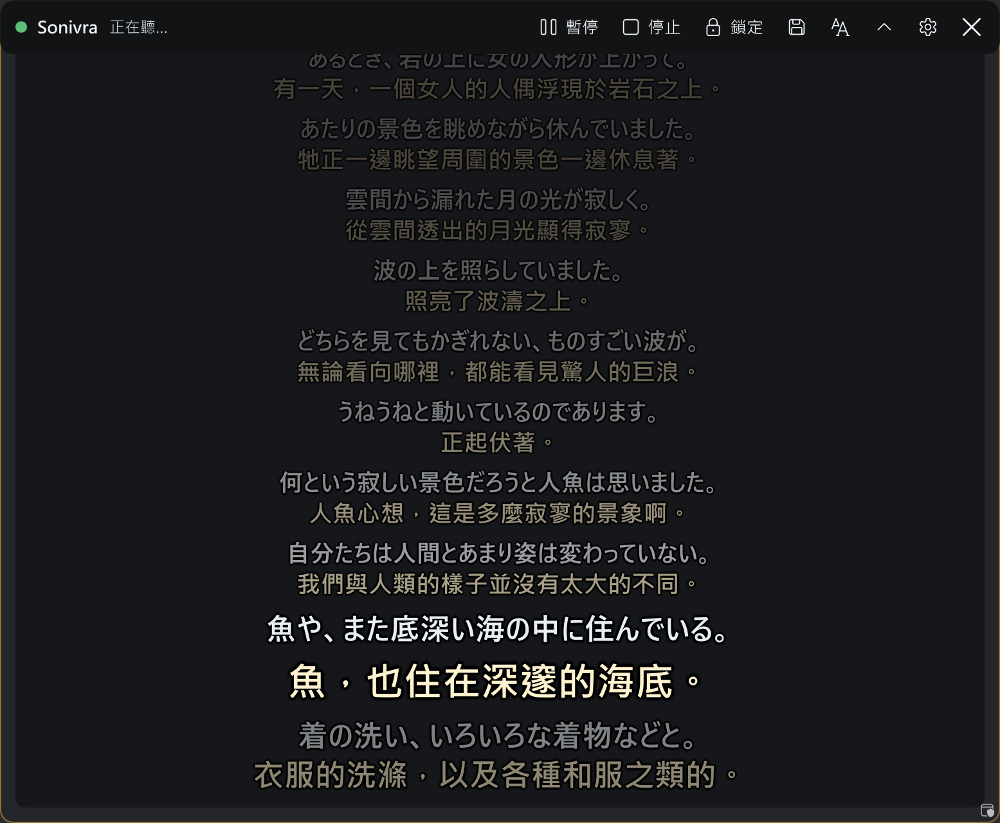
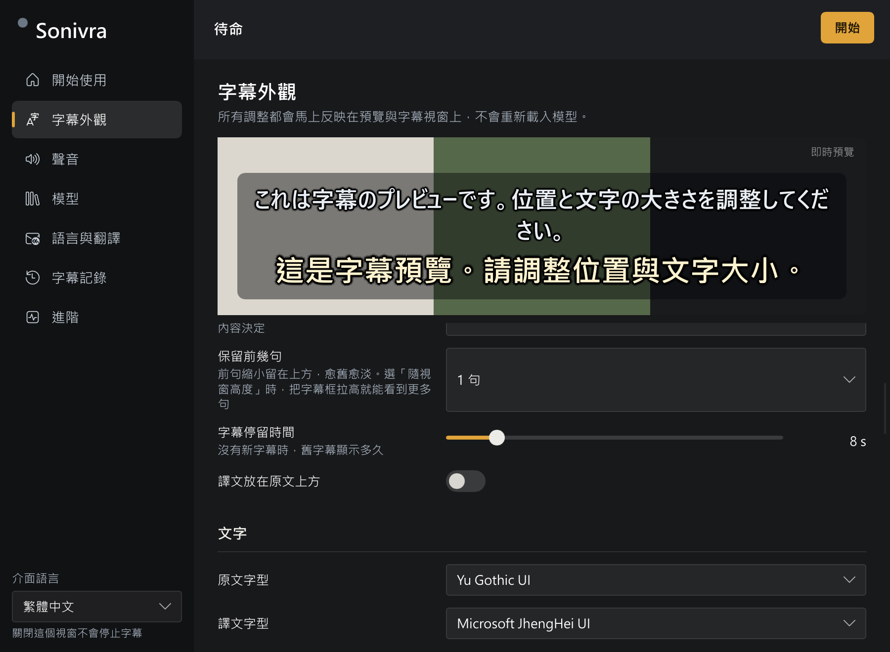

<div align="center">

# Sonivra

Windows 本機即時轉錄與多語言翻譯字幕

<p>


</p>

[繁體中文](README.md) ・ [English](README.en.md) ・ [日本語](README.ja.md)



</div>

## 概述

Sonivra 是 Windows 11 上的即時字幕工具。它擷取電腦播放的聲音，將辨識結果與譯文顯示在懸浮字幕視窗。辨識語言與翻譯目標可分別設定，也能關閉翻譯，只顯示原文。日文到臺灣繁體中文是預設組合，也是目前主要測試的用途。

預設的辨識與翻譯都在本機執行，音訊與文字不會外傳。如果自行設定外部翻譯 API，待翻譯的文字會送到該服務。

應用程式為單一原生執行檔，以 Rust 與 [Slint](https://slint.dev/) 開發，不使用 Electron 或 WebView，也不需要常駐的 Python 或 Node 程序。

## 系統需求

- Windows 11 x64
- 建議使用 NVIDIA 顯示卡。翻譯使用 CUDA 版 llama.cpp，語音辨識使用 Vulkan 版 speech.cpp
- 預設模型組合（Qwen3-ASR 1.7B Q4_K 與 PLaMo 3 Translate 2B Q4_K_M）約 2.9 GB，另需下載執行元件

## 安裝與啟動

1. 將 `Sonivra-<版本>-windows-x64.zip` 解壓縮至任意資料夾。
2. 執行 `Sonivra.exe`。
3. 在「開始使用」頁依提示下載執行元件與模型。下載來源為固定版本，並以 SHA-256 驗證。
4. 按下「開始」。

資料夾內的 `portable` 檔案使設定、模型與記錄儲存於同一資料夾。移除該檔案後，資料改存於 `%LOCALAPPDATA%\Sonivra`。

## 功能

| 類別 | 說明 |
|---|---|
| 辨識與翻譯 | 本機執行。說完一句到譯文完成的中位數為 606 ms（RTX 5070） |
| 暫定文字 | 說話期間每 0.8 秒辨識一次已收到的音訊，以淡色顯示，完整句子辨識後取代 |
| 字幕視窗 | 置頂，可透明、可穿透滑鼠。視窗高度決定顯示句數，最多 300 句，較舊的句子依序淡化 |
| 外觀 | 字級、字型、顏色、背景濃淡與文字效果可在字幕視窗內調整 |
| 音訊來源 | 預設輸出裝置、指定單一程式、麥克風，或系統聲音混合麥克風 |
| 轉錄記錄 | 搜尋、回看，匯出 TXT、SRT、WebVTT。可自動存檔，並可錄製辨識所用音訊 |
| 串流輸出 | 將目前字幕寫入 `transcripts\live.txt`，供 OBS 文字來源讀取 |
| 外觀設定檔 | 儲存與載入字幕外觀、情境說明、詞彙表與辨識提示 |
| 介面語言 | 繁體中文、English、日本語 |

## 使用方式



- 拖曳標題列移動視窗，拖曳任一邊或角調整大小。
- 滾輪回看較早的句子，無操作 20 秒後回到即時字幕。Ctrl＋滾輪調整字級，Shift＋滾輪調整背景濃淡。
- 標題列可設為常駐、滑鼠移入時顯示或隱藏。右鍵開啟設定。
- 鎖定後可啟用滑鼠穿透。

| 快速鍵 | 動作 |
|---|---|
| `Ctrl+Alt+L` | 鎖定或解除鎖定 |
| `Ctrl+Alt+P` | 開始、暫停、繼續 |
| `Ctrl+Alt+H` | 顯示或隱藏字幕視窗 |
| `Ctrl+Alt+↑` ／ `↓` | 回看較早或較新的字幕 |
| `Ctrl+Alt+=` ／ `-` | 放大或縮小字幕 |
| `Ctrl+Alt+S` | 立即儲存目前的轉錄記錄 |

## 記錄、錄音與串流輸出

- 暫停或停止後重新開始，記錄會接續寫入。
- 標題列的儲存按鈕或 `Ctrl+Alt+S` 將目前記錄存為 TXT，位置為 `transcripts` 資料夾。
- 啟用「輸出即時字幕到文字檔」後，畫面上的字幕同步寫入 `transcripts\live.txt`。
- 啟用「錄下辨識的聲音」後，送入辨識的音訊（含靜音）存為 16 kHz 單聲道 WAV，每次開始產生一個檔案，約每小時 115 MB。錄音與字幕記錄的起點相同。
- 「前句顯示」可選擇僅譯文、僅原文或兩者。

## 語言

辨識語言可指定，也可設為自動偵測。設為自動偵測時，翻譯的原文語言同樣自動判斷。預設情境說明是為日翻繁中撰寫，改用其他語言時請一併調整。翻譯語言清單共 53 種，實際支援範圍取決於所選的辨識與翻譯模型。目前主要驗證日文到繁體中文，尚未逐一測試所有語言組合。

## 實驗功能

以下功能預設關閉，可於設定中啟用。

- **翻譯暫定句**：翻譯器閒置時翻譯暫定原文，以淡色顯示。延遲偏高或有語音排隊時自動略過。
- **重翻前一句**：下一句翻譯完成且翻譯器閒置時，以下一句作為前後文重新翻譯前一句。譯文有變動時更新畫面與記錄。

## 限制

- 斷句使用 RMS 音量偵測，不是語音模型。背景音樂會被視為語音，音量過低的來源可能低於門檻，可在「聲音」頁調高靈敏度。
- 暫定文字可能與最終結果不同。只有最終結果會寫入轉錄記錄，預設也只翻譯最終結果。實驗功能可另外開啟暫定句翻譯。
- 辨識與翻譯各使用一個處理程序，辨識佇列長度為 2，翻譯佇列長度為 1。處理速度不足時捨棄較舊的片段。
- 重翻只更新畫面與匯出內容，自動存檔的檔案維持原樣。
- 同時使用麥克風時，外放聲音會被麥克風再次收入，建議使用耳機。
- 尚未提供：說話者區分、重新辨識近期錄音、第二個字幕視窗、安裝程式、自動更新。

## 效能量測

量測條件：release 版本，預設模型組合，以 WASAPI loopback 擷取 75 秒連續日語朗讀（LibriVox《赤い蝋燭と人魚》，公有領域）。測試機為 NVIDIA GeForce RTX 5070（12 GB）、32 GB RAM、Windows 11。

| 項目 | 數值 |
|---|---|
| 翻譯完成的片段 | 21 段，捨棄 0 段 |
| 說完到譯文完成（中位數 ／ 第 95 百分位） | 606 ms ／ 628 ms |
| 斷句等待（最後一段） | 420 ms |
| 辨識時間（最後一段） | 47 ms |
| 翻譯首字時間（最後一段） | 35 ms |
| 主程式記憶體 | 65 MiB |
| 辨識處理程序記憶體 | 258 MiB |
| 翻譯處理程序記憶體 | 2,469 MiB |
| 整張顯示卡用量（NVML） | 執行中 6,674 MiB，未執行 Sonivra 時約 2,700 MiB |

記憶體為工作集（RSS）。顯示卡用量為整張卡的數值，包含其他程式。

## 從原始碼建置

需要 Rust（edition 2024）與 Windows SDK。

```bash
cargo build --release
```

執行檔位於 `target/release/Sonivra.exe`。`cargo test` 執行單元測試。`tests/real_models.rs` 需要實際的模型與執行元件，預設略過。

## 授權

Sonivra 以 [GPL-3.0-only](LICENSE) 授權。靜態連結的 Rust 套件及其授權列於 [THIRD_PARTY_NOTICES.md](THIRD_PARTY_NOTICES.md)。

語音模型與推論執行元件不隨程式發佈，於使用者要求下載時從原始來源取得，各自適用其授權，記錄於 `catalog.json` 與 `runtimes.json`。例如 PLaMo 翻譯模型適用 PLaMo Community License。

`tests/audio` 的日語片段取自 Google FLEURS（CC BY 4.0），出處見 [tests/audio/ATTRIBUTION.md](tests/audio/ATTRIBUTION.md)。
